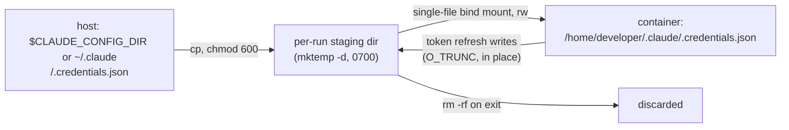

# DESIGN: host_login — reuse the operator's claude login inside the container

Date: 2026-10-28. Status: approved (opt-in key, change #1 of the auth-simplification proposal).

## Intent

An operator who is already logged in to Claude Code on the host should be able to run
claude inside an agentdev container — interactive or one-shot — without minting a token,
writing a `.env`, or hand-seeding an agent home. agentdev does that work, not the caller.

Before this, a headless run had exactly two credential channels: a `.env`/`.envrc` in the
workspace, or credentials the operator had already copied into `mounts.agent_folder`. A
subscription user with no API key had to copy `~/.claude/.credentials.json` around by
hand, and the test suites (Tier C, Tier D) each re-implemented that copy.

## The config key

```json
{ "host_login": true }
```

- `true` — stage the host's claude login into this run.
- `false` or omitted — today's behavior; no host credentials enter the container.

Opt-in by design: it puts a live subscription token inside the container, where an agent
with network egress could read it. The operator chooses that per profile.

## Behavior



1. **Source.** `$CLAUDE_CONFIG_DIR/.credentials.json` when `CLAUDE_CONFIG_DIR` is set,
   else `~/.claude/.credentials.json` — the same resolution claude itself uses.
2. **Stage.** Copy it into a fresh `mktemp -d` (0700) as a 0600 file. The live file is
   never mounted.
3. **Mount.** Bind the staged copy read-write at
   `/home/developer/.claude/.credentials.json`.
4. **Discard.** `cleanup_run` removes the staging dir on exit, like the mcp and skills
   staging dirs.

### Why a single-file read-write bind mount works

Verified in the image's claude binary (2.1.312): the credential store writes with
`open(path, O_WRONLY|O_CREAT|O_TRUNC|O_NOFOLLOW)` — an in-place truncate-and-write, not a
temp-file-plus-rename. A refresh inside the container therefore rewrites the staged copy
through the bind mount and never touches the host file. (`O_NOFOLLOW` is why a symlink
would not work; a bind mount is not a symlink.) Read-write, not read-only, so a refresh
does not fail mid-run.

### Interaction with the agent home

- **Ephemeral home.** The image ships `/home/developer/.claude` owned by `developer`, so
  the mount target's parent exists with the right owner.
- **Persistent home (`mounts.agent_folder`).** agentdev already pre-creates
  `agent_folder/.claude`. The host login is mounted over `.claude/.credentials.json` for the
  run. If the home holds its own credentials file, it is hidden for the run and left
  byte-identical — **the explicit `host_login: true` wins**. If the home had no credentials
  file, the runtime creates an empty mount-point stub on the host; agentdev removes that
  stub after the run (only if it is still empty), so the home is not littered and a later
  run without `host_login` does not see a bogus empty credentials file.

### Precedence with an API key

agentdev does not arbitrate. A workspace `.env` that sets `ANTHROPIC_API_KEY` still loads
as before, and claude's own precedence (an API key in the environment over the OAuth file)
applies.

## Validation (fail-closed)

| Condition | Result |
|---|---|
| `host_login` not a boolean | schema error (exit 4), before launch |
| `host_login: true`, no readable credentials file at the resolved source | `Error: host_login: no claude login found at <path>; log in with claude on the host first` — in `--dry-run` too |
| `host_login: true` with `one-shot.agent` of `omp` or `pi` | `Error: host_login requires the claude agent` |
| `host_login: true`, interactive | allowed (the agent is chosen inside the shell; the login is there if claude is used) |

The file's contents are never printed — messages carry the path only.

## Dry-run

The plan prints:

```
credentials:   host claude login (<source path> -> per-run copy at /home/developer/.claude/.credentials.json, rw; discarded on exit)
```

As with mcp, the staging mount itself is omitted from the dry-run podman command (no
staging happens in dry-run), and the live source path never appears in any `-v`.

## Non-goals

- Copying `~/.claude.json` or anything else from the host home. Only the credentials file
  crosses; it is the minimum that authenticates.
- macOS Keychain-stored logins. agentdev is Linux-first; on a host with no credentials
  file the run fails closed with the message above.
- An inline `-p` prompt and workspace-defaults-to-CWD (changes #2 and #3 of the proposal)
  — not in this change.
- Writing a refreshed token back to the host.

## Security

- **Token in the container (opt-in).** An agent can read the staged token. With
  `network.mode: allowlist`, it can only reach listed hosts; with `off`, egress is open.
  Profiles that hold a login should pair it with an allowlist. Documented in the README.
- **Live credentials never mounted.** Only a per-run copy is mounted; the host file is
  never a mount source. Pinned by a test that greps the podman command for the source path.
- **Refresh-token rotation.** If claude refreshes inside the container and the server
  rotates the refresh token, the host's copy may be invalidated, logging out the host
  terminal session. Access tokens are long relative to a one-shot run, so this is expected
  to be rare. Accepted and documented; not mitigated in this change.
- **Litter.** The staging dir lives in `$TMPDIR` and is removed on exit; a SIGKILL of
  agentdev leaves it behind (0700, operator-owned), the same accepted trade-off as the
  mcp and skills staging dirs.

## Tests

- **Tier A, smoke:** schema accepts `host_login: true`/`false`, rejects a non-boolean.
- **Tier A, matrix (G8):** plan line present when `true`; absent when `false`/omitted;
  fail-closed on a missing credentials file; fail-closed with `one-shot.agent: omp`;
  `CLAUDE_CONFIG_DIR` honored; the source path never appears in the podman command.
- **Tier B, live:** the file is present and writable inside; an in-container write leaves
  the host source byte-identical; with an `agent_folder` that had no credentials, no stub is
  left behind; with an `agent_folder` that had its own credentials, they are untouched.
  Uses `CLAUDE_CONFIG_DIR` pointed at a fake login — the operator's real login is not used.
- **Tier C:** authenticates via `host_login: true` instead of copying credentials by hand;
  `ANTHROPIC_API_KEY` remains the fallback.
