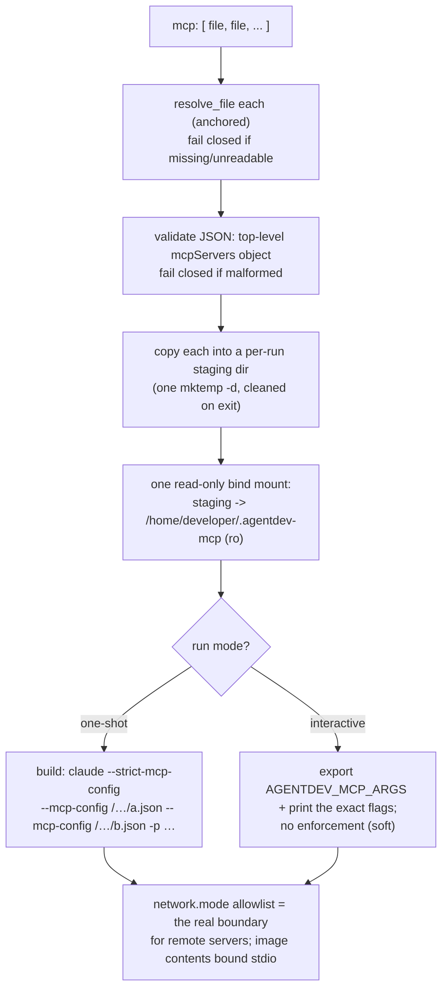

# DESIGN-mcp — per-config MCP server control

## Intent

Let a single agentdev config say exactly which MCP servers an agent may use, by
pointing at MCP config files on disk. agentdev copies those files into the container
and wires the agent to load **only** them. The config file stays the source of
truth; nothing about MCP persists in the container.

This is the companion to the `skills` block: `skills` materializes a read-only
bundle of skills; `mcp` materializes a controlled set of MCP server definitions.

## The problem today

agentdev has no MCP surface at all. MCP reaches a launched agent only as a side
effect of mounting its home: Claude reads servers from the mounted `.claude.json`
(user + local scope), the workspace `.mcp.json` (project scope), and plugin
servers. There is no way for the launch config to say "this run gets these servers
and no others." An operator who wants a locked-down agent has to curate the home by
hand, and an ephemeral home gets whatever the image happens to carry.

See `docs/managing-context-and-memory.md` §1.5 for the three kinds of MCP and how
each is controlled.

## Goals

- One config key names the MCP config files this run may use.
- For a one-shot (headless) run, enforce it as a true allowlist: the agent loads
  **only** those servers, nothing inherited from the mounted home.
- Config is the source of truth; recomputed every launch; nothing persists.
- agentdev does the copying. No dependency on `sm`, `claude mcp`, or editing the
  agent's home state.
- Fail closed: a missing, unreadable, or malformed file aborts the launch.
- Keep credentials out of the files via `${VAR}` references (never copy a literal
  secret, never log file contents).

## Non-goals

- **Not** a controller for claude.ai connectors (Atlassian, Slack, M365, …). Those
  are account-side, gated by `/mcp`, and cannot be set by files or flags. The only
  lever for them is denying egress with `network.mode`. Stated, not solved.
- **Not** hard enforcement for interactive runs. agentdev launches only a `bash`
  shell for interactive; it never constructs the `claude` command, so it cannot
  force a CLI flag onto it. Interactive control is advisory + `network.mode` backstop
  (see "Interactive is soft").
- **Not** a server installer. agentdev stages *config*, not server binaries. A
  stdio server whose `command` is absent from the image simply fails to start; a
  remote server needs egress that `network.mode` governs. Config ≠ server.
- No signature/hash verification of the config files (MCP03 manifest-integrity is
  for untrusted third-party manifests; these are the operator's own files).
- No MCP for `omp`/`pi` — only `claude` has the `--mcp-config`/`--strict-mcp-config`
  surface. An `mcp` block with a non-claude agent aborts (fail closed).

## The `mcp` block

A top-level array of paths to MCP config files on the host:

```jsonc
{
  "image": "agentdev:latest",
  "workspace": { "source": ".", "mount": "ws" },
  "mcp": [
    "~/.config/agentdev/mcp/codebase-memory.json",
    "./ci-servers.json"
  ]
}
```

Each listed file is an ordinary MCP config in the standard shape Claude accepts for
`--mcp-config` and `.mcp.json`:

```jsonc
{
  "mcpServers": {
    "codebase-memory": { "command": "codebase-memory-mcp", "args": ["--serve"] }
  }
}
```

Paths are anchored like every other path in the config (`anchor_path`): relative
entries resolve against the config file's directory, `~` expands to the operator's
home.

**Presence semantics:**

| Config | Meaning |
|---|---|
| no `mcp` key | agentdev does not touch MCP — the agent inherits whatever the mounted home provides (today's behavior). |
| `"mcp": []` | present but empty — a deliberate **deny-all**: a one-shot run gets `--strict-mcp-config` with no config files, so zero MCP servers load (a hardened, MCP-free run). |
| `"mcp": [ … ]` | the listed files are the allowlist. |

The array **is** the allowlist — "load only these files" and "allow only these
servers" are the same statement under `--strict-mcp-config`. There is no separate
`strict` toggle; strict is always on for the enforced (one-shot) path.

## How it works



Mechanically this reuses the machinery the `skills` feature already established:
`resolve_file` + `anchor_path` for the paths, a per-run `mktemp -d` staging dir, a
single read-only bind mount regardless of file count, `register_target` for the
container-side collision check, and cleanup folded into `cleanup_run`.

### One-shot (enforced)

agentdev builds the `claude … -p` command (`agentdev` line ~152 via
`agent_headless_cmd`). It injects `--strict-mcp-config` and one `--mcp-config
<container-path>` per staged file. `--strict-mcp-config` makes Claude ignore every
other scope (user `~/.claude`, project `.mcp.json`, local `.claude.json`) and load
**only** the named files. That is the allowlist, enforced by the Claude binary at
launch.

### Interactive is soft

For interactive runs agentdev execs only `bash`; the operator runs `claude`
themselves, and agentdev cannot attach a flag to a command it does not build. So:

- The files are still staged and read-only mounted.
- agentdev exports `AGENTDEV_MCP_ARGS="--strict-mcp-config --mcp-config … --mcp-config …"`
  and prints the exact `claude` invocation the operator can use.
- No enforcement is claimed. The honest guarantee for interactive is the staged
  files plus `network.mode` as the backstop — exactly how the containment doc treats
  `network.mode: off`: named as a non-boundary rather than oversold.

A `claude` wrapper baked into the image could default the flags for the cooperative
case, but it is bypassable (`command claude`, full path) and requires an image
change, so it is **deferred**, not part of v1.

## Reconciliation with the mounted home

Under `--strict-mcp-config` (one-shot), the mounted home's own MCP definitions are
**ignored** — that is the point, and it is deterministic. The home's `.claude.json`
still provides everything else (auth, settings, history); only its MCP scope is
overridden for the run. No home file is rewritten; the override is a launch flag,
not a mutation. This keeps "config is the source of truth, the home is not edited"
intact, matching the `skills` fold-don't-mutate posture.

Interactive does not override the home (it cannot), so the home's MCP servers remain
active there unless the operator opts into `AGENTDEV_MCP_ARGS`.

## Validation and fail-closed

External input is the array of paths and the file contents. At the boundary:

1. **Each path** is resolved with `resolve_file` (exists, is a regular file,
   readable). A miss aborts the launch naming the path — in dry-run too, so a broken
   config is caught with no container. Paths are only ever resolved and passed as
   argv to `cp`/podman/`claude`; never interpolated into a shell string (MCP05).
2. **Each file** is parsed as JSON and checked for a top-level `mcpServers` object.
   Malformed JSON or a missing/!object `mcpServers` aborts naming the file (MCP03 at
   the boundary; the CLAUDE.md "validate external inputs / fail closed, do not log"
   rule). File **contents are never echoed** to stdout/stderr, so a stray literal
   secret cannot leak into logs (MCP01).
3. **Agent gate:** an `mcp` block with `omp`/`pi` aborts with a message to remove it
   — only `claude` has the surface (same pattern as `mounts.memory` on `pi`).

## Security

- **MCP01 — credentials.** Documented convention: tokens are `${VAR}` references in
  the files (Claude expands them at load from the run's env; a one-shot already loads
  `.env`), so the files stay commit-safe. agentdev never logs file contents and never
  copies a file outside the per-run staging dir. If an operator puts a literal secret
  in a file, it lands only in the per-run staging dir (cleaned on exit) and in the
  container the agent is already trusted to run in.
- **MCP05 — injection.** Paths and container paths are passed as distinct argv
  elements, never built into a `bash -c` string. The `--mcp-config` values are
  container-side staging paths agentdev controls, not operator text.
- **MCP09 — shadow servers.** `--strict-mcp-config` is precisely the "only approved
  servers load" control; the one-shot path gets it unconditionally.
- **Containment.** Read-only is a bind mount, not file perms, consistent with
  `skills` and for the same reason: the agent can reach container-root (see
  `docs/containment-testing.md`), so permission-based immutability is defeatable; a
  rootless-podman read-only mount is not. The staged files are mounted `:ro`.
- **The durable boundaries remain `network.mode` (remote servers) and image
  contents (stdio servers).** The `mcp` block controls intent and the enforced
  one-shot default; it is not itself a containment boundary, and the design says so.

## Decisions (settled)

- **A bare array of file paths**, not a `{store, profile, include}` block. The user
  points at MCP config files they already have; agentdev invents no store layout or
  naming convention. (Rejected: a names-plus-store design — more concepts; and a
  filter-the-home design — would couple agentdev to Claude's multi-scope config
  format, brittle.)
- **Allowlist by construction.** The array is the allowlist; `--strict-mcp-config`
  always on for one-shot. No `strict` key.
- **`[]` = deny-all**, absent = inherit-home (no-op). Distinguished via `_json has`.
- **One read-only mount** of a per-run staging dir, any file count.
- **claude-only**, fail closed for `omp`/`pi`.
- **Interactive is advisory** (`AGENTDEV_MCP_ARGS` + printed flags); enforcement is
  the one-shot path; `network.mode` is the backstop. Image `claude` wrapper deferred.
- **Files validated** for well-formed `mcpServers` JSON; contents never logged.
