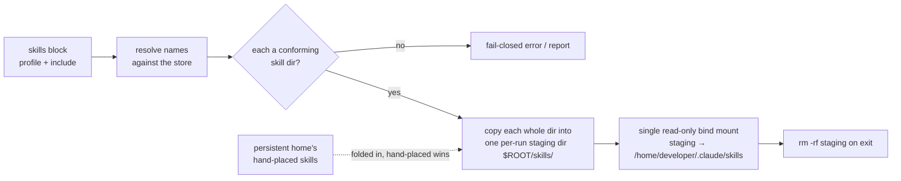

# Skills profiles for agentdev — design

Date: 2026-10-27 · Status: **proposed** (not yet implemented)

This design adds a `skills` block to the agentdev config so a launch can pull a named
**bundle of skills** from one shared, agent-neutral store into the agent's
`.claude/skills` — read-only, assembled fresh from the config each run. It builds on the
[Skill Embedding Standard](https://github.com/gherlein/skill-embedding-standard)
(`SKILLS-DIRECTORY-SPEC`), which names the store and the per-skill directory contract.

## Intent and why

Skills are the man pages agents read. Today, getting a curated set of them into an agentdev
run means hand-placing directories into the mounted home, or running `sm sync --copy` against
it by hand. We want to declare, in the config that already defines the whole launch, *which*
skills this run should have — by naming a reusable **profile** or listing skills inline — and
have agentdev materialize exactly that set, immutably, with the config as the source of truth.

## Goals

- A `skills` block in the agentdev config selects skills by **named profile** and/or an
  **inline list**, resolved against one shared store.
- The **config is the source of truth**: the skill set is computed and materialized on every
  launch; nothing is persisted into or drifts within a reused home.
- Skills are **immutable** inside the container — the agent cannot modify them mid-run.
- **agentdev does the work** itself (resolve + assemble + mount); no runtime dependency on
  `sm` or any other tool.
- One shared place for all skills (the store); profiles are named subsets of it.
- Works identically for a persistent `agent_folder` and an ephemeral (clean-room) home.

## Non-goals

- Not a skill registry, versioning, or dependency resolver — out of scope for the store spec
  and for us (see the standard's §7).
- Not a writable "scratch skills" area; skills are read-only inputs.
- Not a change to how the store itself is populated — that is a producer's job (a `git`
  checkout, a package, a tool's `install-skill`). agentdev is a **consumer** of the store.

## The shared store

Per the Skills Directory Specification, the store is `$XDG_DATA_HOME/skills/` (default
`~/.local/share/skills/`). It is **flat**: each immediate subdirectory is exactly one skill,
its directory name is the skill's identity, and there is no index or manifest. agentdev reads
it as a conforming consumer: it enumerates immediate subdirectories, treats each conforming
one as a skill, and reports (does not silently accept) non-conforming entries.

Because the store must stay flat and manifest-free, **profiles are defined outside the store**
(see "Profiles" below) — never as a file inside it.

## Configuration: the `skills` block

```jsonc
"skills": {
  "store":   "~/.local/share/skills",         // optional; default = XDG store
  "profile": "backend",                        // optional; a named bundle
  "include": ["git-ops", "documentation"]      // optional; explicit names
}
```

- `profile` and `include` **compose**: the final set is the profile's skills plus the inline
  names (de-duplicated by name).
- Omitting the whole block means no managed skills (and no store dependency) — nothing changes
  from today.
- Each name must resolve to a conforming skill in the store; an unresolved name is a
  **fail-closed error** with a clear message (consistent with agentdev's strict schema), never
  a silent drop — a requested skill that silently vanishes is worse than a refused launch.

## How it materializes: one read-only mount



1. Resolve `profile` + `include` to a set of skill names; look each up in the store.
2. **Copy** each selected skill's whole directory into one per-run staging directory under the
   run's temp root (`$ROOT/skills/<name>/`).
3. Mount that one staging directory **read-only** at `/home/developer/.claude/skills`.
4. Remove the staging directory on exit (the existing cleanup trap).

The mount count is **exactly one**, regardless of how many skills are selected — 5 or 50, it is
a single `-v <staging>:/home/developer/.claude/skills:ro`.

## Why a read-only mount, not copy-then-chmod

The obvious alternative is to copy skills into the container and `chmod a-w`. That gives only
**soft** immutability: the containment-trust suite (`tests/live-containment.sh`) proved the
agent can reach **container-root via `sudo`** (uid 0 in the user namespace). Container-root can
`chmod +w` and rewrite its own skills. A **read-only bind mount** cannot be remounted
read-write from inside — that needs host-level `CAP_SYS_ADMIN`, which rootless podman +
`--userns=keep-id` denies. So the RO mount is the only mechanism that makes skills immutable
against the very agent we sandbox. See [`docs/containment-testing.md`](docs/containment-testing.md).

## Why copy into staging, not symlink into the store

The staging directory holds **copies**, not symlinks back to the store. A symlink in the home
pointing at `~/.local/share/skills/<name>` dangles inside the container, because the store is
not mounted there — the exact trap documented in
[`docs/applying-sm-managed-skills.md`](docs/applying-sm-managed-skills.md). Skills are small
(text + scripts); copying a couple dozen into a temp dir is negligible, and it yields one
self-contained directory to mount read-only.

When copying, agentdev follows the standard's guidance: a symbolic link inside a skill that is
absolute or escapes the skill directory is **omitted and reported**, so a skill cannot smuggle
host paths into the container.

## Profiles: where they are defined

A profile is a named subset of the store, defined **outside** it so the store stays flat and
spec-pure. Simplest form: one file per profile under `~/.config/agentdev/profiles/<name>`,
each line a skill name (blank lines and `#` comments ignored). The config's
`"skills": { "profile": "<name>" }` names it; agentdev reads the file and resolves each name
against the store.

(Open: a single `profiles.json` mapping names→lists is an equivalent alternative; the per-file
form is the simplest to edit and diff.)

## Reconciling with the existing mounts

The skills mount is orthogonal to everything agentdev already mounts:

- **`mounts.agent_folder`** still provides the read-write home (`.claude`, `.claude.json`). The
  skills mount lands on the `.claude/skills` subpath as a nested, read-only bind mount.
- **Persistent home with hand-placed skills:** mounting over `.claude/skills` would otherwise
  shadow skills already in the home. agentdev folds copies of those into the staging dir during
  assembly, so one mount presents both sets. On a **name collision**, the hand-placed skill
  **wins** (agentdev keeps it, skips the profile's, and warns) — a launch never overwrites or
  hides a skill you placed by hand.
- **Ephemeral home (no `agent_folder`):** there is no home skills dir to fold in; agentdev just
  mounts the staged profile skills. podman creates the `.claude/skills` mountpoint as needed.
- **`mounts.history` / `mounts.memory`** redirect `.claude/projects/...`; **`read_only` /
  `read_write`** pairs land at their own dests — all different subtrees, no interaction.
- **Single-instance lock** is unaffected: assembly writes only to the per-run temp staging dir,
  never to the host home.

## Validation and fail-closed

- `skills.store` (string), `skills.profile` (string), `skills.include` (string list) join the
  strict schema; unknown keys under `skills` are rejected like any other.
- An unresolved skill name, a missing profile file, or a missing store is a hard error with a
  migration-style hint — consistent with agentdev's fail-closed posture.
- A non-conforming directory in the store (no `SKILL.md`, name≠dir) is reported and skipped, per
  the standard's consumer rules.

## Security considerations

- Skills are instructions and scripts the agent may run. Mounting them read-only stops the agent
  from *mutating* them, not from *running* them; what running code can reach is bounded by the
  container (proven by the containment suite).
- agentdev copies only from the user-owned store and omits escaping/absolute symlinks, so a
  skill cannot expose host paths outside itself into the container.
- The staging copy carries no credentials and is removed on exit.

## Decisions (settled)

- **Profile file format:** one file per profile at `~/.config/agentdev/profiles/<name>`, one skill
  name per line; blank lines and `#` comments ignored. (Simplest to edit and diff.)
- **One store.** `skills.store` is a single path (default the XDG store), not a list. Layering across
  multiple stores is out of scope for v1.
- **Messages:** collisions and non-conforming store entries are reported on `stderr` in agentdev's
  existing `Note:` / `Error:` style.
- **Default is fold-and-coexist** (a persistent home's hand-placed skills are kept; profile skills are
  added read-only; hand-placed wins on a name collision). A "whole skills set is the profile" opt-in
  is deferred (future, additive).
