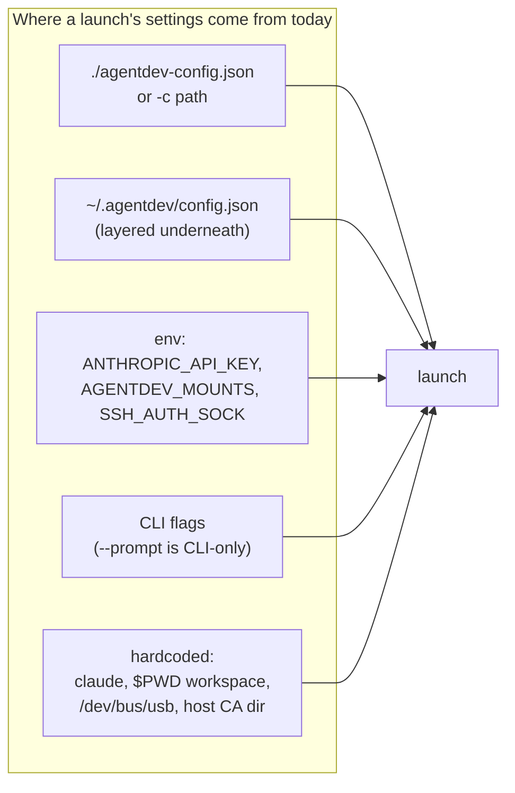

# Goal vs. Implementation: Gap Analysis

> **Historical (2026-10-25).** This was the "before" picture that drove the redesign, and it
> has since been superseded twice. The current design is: one strict, fail-closed config file
> (`-c` / `$AGENTDEV_CONFIG` / `./agentdev-config.json`); a run is interactive by default or
> headless via a `one-shot` block (`agent`, `model`, `prompt`); the agent's state is just host
> folders you mount (`mounts.agent_folder`, with optional `history`/`memory` redirects);
> credentials and model routing come from a `.env`/`.envrc` in the workspace (no `auth`/model
> object); agents are selected by short name (claude/omp/pi); and the CLI is `--dry-run` / `-c`
> / `--prompt` / `-- command`. The specifics below (profile modes, auth modes, model object,
> template seeding) are **obsolete**. See [`README.md`](../README.md), [`VISION.md`](../VISION.md),
> and [`DESIGN.md`](../DESIGN.md) for the current design. Kept for the record.

*Reviewed 2026-10-25 against commit `4720ac4`.*

## The goal

Launch an agentic environment where **every parameter comes from one config file**.
The config must be able to set:

| # | Parameter | Meaning |
|---|---|---|
| G1 | **Agent** | Which coding agent runs, for example Claude Code, opencode, or omp |
| G2 | **Model** | Which model the agent connects to |
| G3 | **One-shot prompt** (optional) | If set, the agent runs once on it, headless, and exits |
| G4 | **Mounts** | Exactly which host folders are mounted, and whether each is read-only or read-write |
| G5 | **Network** | How much of the internet the container can reach, if any |

The goal also implies:

- **G0: the file is the whole truth.** If you read the config, you know what the container
  gets. Nothing important comes from outside the file, and nothing in the file is
  silently ignored.

## Scorecard

| Goal | Status | Summary |
|---|---|---|
| G0 file is the whole truth | **Fails** | Values also come from layered config, env vars, and implicit defaults. Misspelled keys and unknown values are ignored without an error. |
| G1 agent | **Not implemented** | `agent.name` is read and only written to `agentdev.meta.json`. Claude Code is hardcoded. |
| G2 model | **Not implemented** | No key, flag, or env passthrough for model or endpoint |
| G3 one-shot prompt | **CLI only** | `--prompt <file>` works, but no config key exists for it |
| G4 mounts | **Partial** | Explicit ro/rw maps work. The workspace source is always `$PWD`, and several host mounts are added implicitly. |
| G5 network | **Mostly met** | `off` / `allowlist` / `none` exist. `off` (full internet) is the default, and the allowlist covers HTTP(S) only. |



## G0: the config file is not the whole truth

### G0.1 Misspelled or unsupported keys are ignored

`lib/jsoncfg.py` walks dotted keys and treats a missing key as "use the default"
(`lib/config.sh:47-56`). There is no schema, so a misspelled key is never reported.

Verified with `--dry-run`:

```json
{ "netwrok": { "mode": "none" },
  "agent":   { "name": "opencode", "model": "claude-opus-5-5", "prompt": "do x" } }
```

The result was `network: off`, which means full internet. The launch used Claude Code
with the default model and opened an interactive shell. Every key in that file was
ignored without a warning.

This is the most dangerous gap. A typo in a security setting quietly turns the
setting off.

### G0.2 Values that are read but never validated

| Key | What happens with a bad value |
|---|---|
| `workspace.trust` | Not validated. Any value other than `workspace-only` behaves like `skip-permissions`. |
| `profile.keep`, `sandbox.ssh`, `mounts.confirm_rw`, `network.log`, `network.mitm` | Compared to the literal string `true`, so `"yes"` or `1` is silently treated as false. |
| `agent.name` | Any string is accepted and only recorded in meta |

`network.mode`, `mounts.workspace`, `auth.mode`, and the mode are validated
(`agentdev:258-263`, `agentdev:330`).

### G0.3 Keys that are read but do nothing

| Key | Location | Effect |
|---|---|---|
| `workspace.isolation` | `lib/config.sh:115` | None. `cow` / `patch-only` were never built. |
| `template.strategy` | `lib/config.sh:105` | None. Only `copy` exists. |
| `agent.name` | `lib/config.sh:91` | Written to `agentdev.meta.json` only |
| `template.layers` (VISION example) | not read | None |

### G0.4 Settings come from outside the file

| Source | Effect | Where |
|---|---|---|
| `~/.agentdev/config.json` | Fills in any key the project file omits. Its `mounts` maps are **added** to the project's. | `lib/config.sh:47-64`, `lib/mounts.sh:186-190` |
| `AGENTDEV_MOUNTS` env var | Adds read-only mounts | `lib/mounts.sh:145-151` |
| `ANTHROPIC_API_KEY` env var | Under `auth.mode=auto`, it decides the auth mode | `agentdev:270-279` |
| `SSH_AUTH_SOCK` env var | Whatever socket it names is forwarded (default `sandbox.ssh=true`) | `agentdev:376-378` |
| Launch directory (`$PWD`) | Always becomes the workspace | `agentdev:19`, `agentdev:412` |

A config file copied to another machine or user can therefore produce a different
container.

### G0.5 Relative paths resolve against `$PWD`, not the config file

`-c some/dir/agentdev-config.json` with `"./ref": "/ref"` resolves `./ref` against the
launch directory (`lib/mounts.sh:46-50`). The same is true of `template.source`. The
file's meaning depends on where you run it from.

## G1: agent selection is not implemented

- `agent.name` defaults to `claude` and is only used in `write_meta` (`lib/meta.sh:35`).
- The home mounts are hardcoded to `.claude` + `.claude.json` (`agentdev:358-361`).
  DESIGN.md §10 said they come from a per-agent table. They do not.
- The `--prompt` command is hardcoded: `claude --dangerously-skip-permissions -p ...`
  (`agentdev:181`).
- Seeding, auth, trust, memory encoding, and `inherit-credentials` are all specific to
  Claude Code.
- The image ships `opencode` and `omp`. You can run them by hand inside the shell, but
  agentdev does not manage their homes, auth, or prompts.

## G2: model selection is not implemented

Nothing in the launcher, config, or image passes a model or an API endpoint. The model
is whatever Claude Code defaults to for the logged-in account. You can set
`/model` interactively, or use `-- claude --model ...`, but nothing in the config does it.

"Model to connect to" can mean two different things. Each needs its own design:

1. **Model ID** (for example `claude-opus-5-5`). For Claude Code this is
   `--model` or `ANTHROPIC_MODEL`.
2. **Endpoint/provider** (Anthropic API, Bedrock, Vertex, a gateway, a local model).
   For Claude Code this is `ANTHROPIC_BASE_URL` or the provider env vars plus credentials.
   It also interacts with G5: under `network.mode=allowlist`, the endpoint host must be
   on the allowlist, or the agent cannot reach its model.

## G3: the one-shot prompt is CLI-only

`--prompt <file>` works well. The file is mounted read-only and stdin is closed
(`agentdev:172-182`). But it has no config key, so a config file cannot describe a
one-shot run.

The prompt path also hardcodes `--dangerously-skip-permissions`. That overrides
`workspace.trust`, including the `workspace-only` trust that `--eval` selects. The
user guide's claim that `--eval` is "not skip-permissions" is false for `--eval --prompt`.

There is also no config key for the default command. Without `--prompt`, the container
opens `bash`, not the agent.

## G4: mounts are only partly config-defined

What works: `mounts.read_only` and `mounts.read_write` maps with absolute, relative, or
`&` destinations; `mounts.workspace` = `rw|ro`; collision detection; `confirm_rw` and
`rw_allow`.

Gaps:

| Gap | Detail |
|---|---|
| Workspace source is not configurable | It is always `$PWD`, mounted at `/<basename of $PWD>` |
| Implicit host mounts | Added outside the config's mount maps: `~/.ssh` (ro) and the SSH agent socket unless `sandbox.ssh=false`. Host CA anchors are always added if present. `/dev/bus/usb` is always passed as a device when present on the host. |
| Missing config mount kills the launch with a misleading message | A missing `mounts.*` source prints `Warning: skipping ...` and then the launcher exits 1 with no error. `((MOUNT_ERRORS++))` from 0 returns status 1 under `set -e` (`lib/mounts.sh:175`). Failing is correct, but the message says it was skipped. |
| CLI and config disagree on missing mounts | A missing `-ro`/`-rw` path is really skipped and the launch continues (`lib/mounts.sh:133-134`) |
| Config mounts are merged across files | The user config's maps are added to the project's |
| `~` only | Sources expand `~` but not `$VAR`. The user guide said otherwise. |

The profile mounts (`~/.claude`, `~/.claude.json`, the memory store) are agentdev's own
and are expected. The rest of the list above is not visible in the config.

## G5: network is mostly met

| Mode | Reach | Notes |
|---|---|---|
| `off` (default) | Full internet, podman default networking | The default is the least restrictive setting |
| `allowlist` | Only listed `host`, `host:port`, `*.host`, `host/path` | HTTP(S) only, through a proxy sidecar. Other protocols (git over SSH, raw TCP) are blocked. Path rules for HTTPS need `mitm=true`. |
| `none` | Nothing | `--network none` |

Gaps and caveats:

- The default is full internet. A config that omits `network` gets full access.
- Under `allowlist`, the model endpoint is not added automatically. Only `--eval` adds
  `api.anthropic.com`, and only when the list is empty (`agentdev:255`).
- The SSH agent socket is still forwarded under `allowlist`/`none` unless `sandbox.ssh=false`.
  It is a host channel, not a network one, but it is outside the network policy.

## Other spec-vs-code drift found and fixed in the docs

| Doc claim | Reality |
|---|---|
| DESIGN §4/§11, README Status: allowlist, egress logging, `report` are Phase 2 | Implemented (`lib/net.sh`, `image/proxy.py`) |
| DESIGN §9: `skip-permissions` passes `--dangerously-skip-permissions` when launching claude | Only `--prompt` passes it. In an interactive shell, `skip-permissions` and `prompt` behave the same. |
| DESIGN §2.3: `collect_mounts` aborts on any error | It warns and skips, except for the `set -e` accident above |
| DESIGN §2.4: a doctor preflight runs at launch | It does not. `doctor` is a separate command. |
| DESIGN §10: `PROFILE_MOUNT` comes from a per-agent table | Hardcoded |
| VISION §12 example: `network.mode: "isolated"`, `template.layers` | `isolated` is rejected as an invalid mode. `layers` is not read. |
| User guide §7: sources accept `$VAR`; "launch directory is always read-write" | Only `~`. The workspace can be `ro`. |

## Proposed config contract (not implemented)

The shape below would meet G0–G5. It is a proposal for discussion, not current
behavior.

```json
{
  "agent":   { "name": "claude", "image": "ghcr.io/gherlein/agentdev@sha256:...",
               "model": "claude-opus-5-5", "endpoint": "https://api.anthropic.com" },
  "prompt":  { "file": "./task.md" },
  "mounts":  {
    "workspace":  { "source": ".", "mode": "rw" },
    "read_only":  { "./ref": "/ref" },
    "read_write": { "./out": "/out" }
  },
  "network": { "mode": "allowlist", "allow": ["api.anthropic.com"] },
  "sandbox": { "ssh": false, "usb": false, "host_ca": true }
}
```

Required behavior changes to go with it:

1. **Strict schema.** Reject unknown keys, wrong types, and unknown enum values before
   launch. Fail closed with the key path in the message.
2. **Paths relative to the config file**, not `$PWD`.
3. **No hidden inputs.** Either drop the user-config layering and `AGENTDEV_MOUNTS`, or
   make `--dry-run` show which file supplied each value. Make SSH, USB, and CA
   passthrough explicit keys that default to off.
4. **Per-agent table** for home paths, prompt command, model flag, and auth env, so
   `agent.name` selects real behavior.
5. **Allowlist and model endpoint interlock.** Under `allowlist`, fail if the endpoint
   host is not allowed, or add it automatically.
6. **Consistent missing-mount handling.** Fail with a clear error from both CLI and
   config.

## Decisions needed

1. **Model:** does "model" mean the model ID, the endpoint/provider, or both?
2. **Prompt:** in the config, a file path only (matching `--prompt`), inline text, or both?
3. **Layering:** keep `~/.agentdev/config.json` as a fallback layer, or make the project
   file self-contained?
4. **CLI overrides:** keep every flag as an override, or keep only per-run actions
   (`--dry-run`, `--reseed`) so the file remains the whole truth?
5. **Network default:** should a config with no `network` key mean `off` (full internet,
   current behavior) or `none`?
6. **Which agents first** after Claude Code: `opencode`, `omp`, or both?
