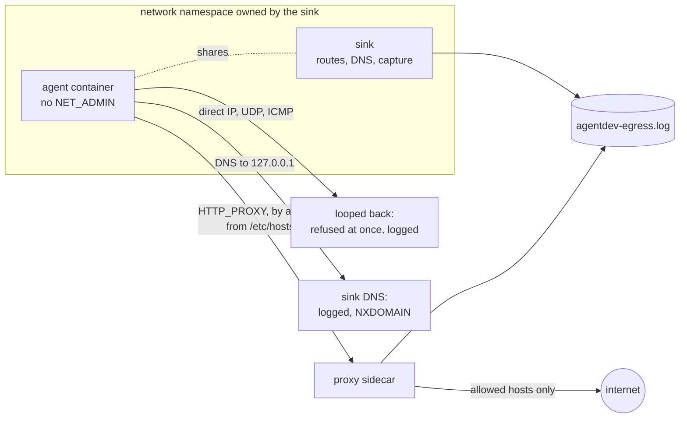

# Network monitoring: seeing every attempt an agent makes

agentdev's `allowlist` mode stops an agent reaching any host you did not list. This page is
about the other half: **seeing every attempt**, including the ones that never touch the proxy,
and telling an agent program's own background traffic apart from something the model asked
for. It covers what is logged, how, how to read it, and how to quiet the agents' own traffic
so that what is left means something.

## Why the proxy log alone was not enough

The proxy only sees requests that are sent to it. Before 2026-11-01 three kinds of attempt
left no record at all:

| Attempt | What happened | Logged? |
|---|---|---|
| A DNS lookup of any name | podman's network DNS forwarded it to the host's resolver, **and the query left the machine** | no |
| A direct connection to an IP address (`curl --noproxy`, a raw socket, a Go program that ignores `HTTPS_PROXY`) | refused inside the container's kernel: "Network is unreachable" | no |
| UDP, ICMP | refused the same way | no |

The first is a way out, not just a blind spot: a name such as `<secret>.attacker.example` carries
data to whoever runs that domain's DNS server, and the proxy never sees it. Claude Code alone
looks up `github.com` twelve times at startup this way (measured below).

The other two are blocked, but silently. If a model tells its agent to POST somewhere, or writes
a program that phones home, you want a line in a log, not a failure nobody saw.

## The sink

Every `allowlist` run, and every `none` run with `network.log: true`, now has a second sidecar:
the **sink** (`image/sink.py`, run from the same image as the proxy). The agent does not get a
network of its own; it **joins the sink's network namespace** (`podman run --network
container:<sink>`). The sink holds `NET_ADMIN` and `NET_RAW`; the agent never does, so the agent,
even as root through `sudo`, cannot change what the sink set up.



What the sink does:

1. **Routes every outside address back.** It adds `local default dev lo` (and the IPv6
   equivalent), so any address that is not on an attached network counts as local. A
   connection to `1.2.3.4:443` loops back inside the namespace and is refused in about a
   millisecond instead of hanging or leaving. The internal network keeps its own, more specific
   route, so the proxy is still reached normally.
2. **Captures every new flow.** A raw socket on every interface records each TCP SYN, UDP
   datagram and ICMP echo request: looped-back attempts to outside addresses, and anything
   leaving the real interface except the connection to the proxy.
3. **Answers all DNS itself.** The agent's `/etc/resolv.conf` points at `127.0.0.1`, where the
   sink logs the name and query type and answers NXDOMAIN. No name reaches a real resolver. A
   query sent straight to an outside resolver (`dig @8.8.8.8 ...`) loops back to the sink too,
   so it is logged by name as well as by address.
4. **Keeps the agent working.** The agent's `/etc/hosts` lists the proxy's address, so it finds
   the proxy without DNS, and its own fixed hostname (`agentdev`), so `sudo` does not complain.

The internal network itself is now created with `--disable-dns`, so podman's own DNS server is
not there to be queried either.

agentdev waits until the sink reports ready before it starts the agent, and refuses the run if
the sink cannot set itself up. Both sidecars and the networks are removed when the run ends.

### Which runs get it

| `network.mode` | `network.log` | Result |
|---|---|---|
| `off` | any | host networking; nothing logged (not a containment mode) |
| `none` | `false` | `--network none`: no network, attempts fail silently |
| `none` | `true` | the agent joins a sink with **no network at all**: every attempt is refused and logged |
| `allowlist` | `false` | proxy and sink: DNS is closed and bypass attempts refused, but nothing is written |
| `allowlist` | `true` | proxy and sink, both writing the egress log |

`none` with `log` is meant for steps that run code you did not write and that should never
need a network: a build, a test suite, a scorer. Code that tries to phone home shows up in the
log.

## Reading the egress log

With `network.log: true` the proxy and the sink append to one file,
`<agent_folder>/agentdev-egress.log`, one tab-separated line per decision:

```text
ISO8601  ALLOW|DENY  KIND     destination                   detail
```

| KIND | Written by | destination | detail |
|---|---|---|---|
| `CONNECT`, `GET`, `POST`, ... | proxy | `host:port` | the path (`-` for a CONNECT tunnel) |
| `DNS` | sink | the name looked up | the query type (`A`, `AAAA`, `TXT`, ...) |
| `TCP`, `UDP` | sink | `address:port` (IPv6 as `[address]:port`) | `-` |
| `ICMP` | sink | the address | `type 8` (echo request) |
| `IP` | sink | the address | `proto N`, any other protocol |

Every sink line is a `DENY`: nothing the sink sees can leave. Control characters in a name are
replaced with `?`, so a hostile name cannot break the format.

```bash
# Tally by decision, kind and destination
cut -f2,3,4 <agent_folder>/agentdev-egress.log | sort | uniq -c | sort -rn

# Everything that tried to go around the proxy
grep -P '\tDENY\t(DNS|TCP|UDP|ICMP|IP)\t' <agent_folder>/agentdev-egress.log
```

An example from a real Claude Code run (tabs shown as spaces):

```text
2026-11-01T21:14:02+00:00  ALLOW  CONNECT  api.anthropic.com:443  -
2026-11-01T21:14:03+00:00  DENY   DNS      github.com             A
2026-11-01T21:14:03+00:00  DENY   CONNECT  github.com:443         -
```

## Telling the agent program from the model

A model cannot open a connection. It can only ask its agent to run a tool: a shell command, a
fetch, a script. Everything else in the log is the agent program itself starting up, checking
for updates, sending telemetry or discovering models. So:

- **The transcript is the evidence of intent.** Every tool call is in the agent's session file
  in its home (omp: `.omp/agent/sessions/`, Claude Code: `.claude/projects/`). A tool call that
  names a URL, a host or an IP, runs a network command (`curl`, `wget`, `nc`, `ssh`, `git
  clone`, `pip install`, `go get`) or writes network code is the model reaching out.
- **The egress log is the evidence of the attempt**, with a timestamp. A line that falls inside
  a tool call's run time belongs to that tool call.
- **Each agent program has a fixed startup baseline** (next section). A line in the baseline that
  happens outside any tool call is the program; anything else needs a look.

The agentdev-lab factory does this correlation for every step and reports, per run, how many
attempts were model-initiated, harness baseline, or unexplained.

## Quieting the agents' own traffic

The fewer lines an agent program writes on its own, the more each remaining line means. These
settings were measured on 2026-11-01 with the image's omp 18.13.2 and Claude Code 2.1.312, one
one-shot run each, `allowlist` with `log: true`.

### Claude Code

Put these in the home's `.claude/settings.json` (the `env` block applies them to Claude Code
itself):

```json
{
  "env": {
    "CLAUDE_CODE_DISABLE_NONESSENTIAL_TRAFFIC": "1"
  }
}
```

| Measured | Default | With the setting |
|---|---|---|
| `ALLOW CONNECT api.anthropic.com:443` | 31 | 6 |
| `DENY CONNECT http-intake.logs.us5.datadoghq.com:443` (error logging) | 1 | 0 |
| `DENY CONNECT github.com:443` | 3 | 3 |
| `DENY DNS github.com` | 12 | 12 |

The setting turns off telemetry, error reporting and other non-essential calls, so most of the
traffic to `api.anthropic.com` that is not the model itself goes too. The run's answer was the
same.

The `github.com` attempts remain. `CLAUDE_CODE_DISABLE_OFFICIAL_MARKETPLACE_AUTOINSTALL=1` did not
remove them, and their purpose is not identified yet: the proxy's MITM mode would show the path,
but MITM is currently broken (see below). They are a stable startup baseline, three CONNECTs and
twelve lookups, always to `github.com`.

### omp

List the built-in providers that discover models without a key under `disabledProviders` in the
home's `.omp/agent/config.yml`:

```yaml
disabledProviders:
  - anthropic
  - openai
  - google
  - alibaba-coding-plan     # coding-intl.dashscope.aliyuncs.com
  - kilo                    # api.kilo.ai
  - venice                  # api.venice.ai
  - zenmux                  # zenmux.ai
  - commandcode             # api.commandcode.ai
  - charm-hyper             # hyper.charm.land
```

| Measured | Default | With the setting |
|---|---|---|
| `DENY CONNECT` to the six provider hosts above | 6 | 0 |
| `DENY CONNECT catalog.stencil.so:443` | 1 | 1 |

Each ID was checked on its own: `charm-hyper` stops `hyper.charm.land`, where `hyper` and
`charm` do not. Unknown IDs in the list are ignored.

`catalog.stencil.so` is omp's shared model catalogue (`models.json.zstd`). It is fetched even
with every built-in provider disabled, and no setting or environment variable in omp 18.13.2
turns it off, so it stays as one baseline line per start.

omp keeps discovery results in `~/.omp/agent/models.db`. A home that starts empty every run (as
in agentdev-lab's factory) has no such cache, so it makes these attempts at every start.

### pi

Not measured yet. Check a first run's egress log the same way before you rely on a baseline.

### What a quiet run looks like

| Agent | Baseline left after quieting |
|---|---|
| Claude Code 2.1.312 | `DENY CONNECT github.com:443` ×3, `DENY DNS github.com` ×12 |
| omp 18.13.2 | `DENY CONNECT catalog.stencil.so:443` ×1 |

Anything beyond those lines in a quiet run is worth reading.

## Limits

- **The proxy's MITM mode is broken.** With `network.mitm: true`, HTTPS through the proxy fails
  with a connection reset, on `main` before this change as well. Domain-level `allowlist` (the
  default) is unaffected.
- **HTTPS contents.** For allowed hosts the log shows the host, not the path, unless MITM is on.
- **No process names.** The log says what was attempted and when, not which process in the
  container made the attempt. The transcript correlation above fills most of that gap.
- **Packets, not intentions.** The sink logs a flow when it starts. A program that never sends
  anything (it only builds a URL) is caught by reading the transcript or the code, not by the
  sink.
- **`off` is unmonitored.** Host networking has no proxy and no sink.

## Tests

- `tests/test_sink.py` (offline, in `make test`): DNS parsing and the NXDOMAIN reply, which
  frames count as attempts, and the log format.
- `tests/matrix.py` (offline): the launch plan for each mode, including that the agent joins the
  sink's namespace with its own `resolv.conf`, `hosts` and hostname.
- `tests/live.sh` (`make test-live`, needs podman and the image, no internet): in both `allowlist`
  and `none` + `log`, a lookup of a unique name fails and is logged by name; a direct TCP
  connection to `1.2.3.4:443` fails at once and is logged; a UDP datagram is logged; the agent,
  as root, cannot change the sink's routes; the proxy is still reachable; no sink is left behind.
