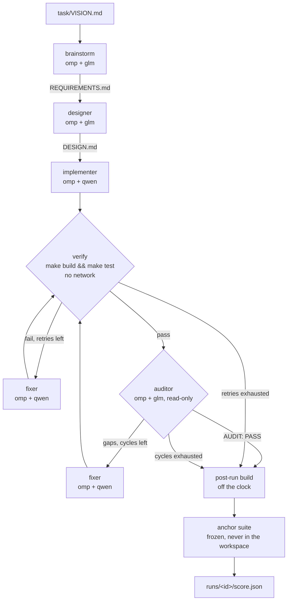

# factory-test

This folder runs the `pngdec` **software-factory benchmark** through agentdev, and holds every
test run. The task, the stages, the models and the frozen 32-case acceptance suite all come from
`~/h/src/er/agents/factory-test`, the erg spec-pipeline experiment. Only the harness differs:

- each stage is an agentdev one-shot: **omp** in an isolated container, with egress only to
  LiteLLM;
- the stage order and every budget are enforced by `factory.sh`, not by a "lead" prompt.

That second point is lever #1 from the erg findings: the pipeline overran its prompt-stated budget
(6 audit loops against a budget of 3).



## Prerequisites

- podman, python3 and git on the host. Go is **not** needed on the host: every build, test and
  scoring step runs in a network-less agentdev container.
- The agentdev image built from current main (`make build` in the repo root). It needs:
  - the login-shell `PATH` fix, so `go` resolves in `bash -lc`;
  - the proxy fixes (keep-alive, slow responses);
  - the signal fix, so a capped step really stops.
- LiteLLM at `http://dgx1.herlein.me:4000`, serving `glm-4.5-air` (dgx2) and `local-qwen` (dgx1).

## Run a test

```bash
cd factory-test
make selftest            # first: reference = 32/32, a fake binary must score lower
make run                 # one full run (local models only; about 1-1.5 h)
make run LABEL=baseline  # name the run
make results             # table of every run
make score RUN=runs/<id> # re-build and re-score an existing run
```

Budgets are environment variables:

| Variable | Default | Meaning |
|---|---|---|
| `VERIFY_RETRIES` | 3 | fixer attempts after a failed `make build && make test` |
| `AUDIT_CYCLES` | 3 | auditor rounds before the run stops as `audit-budget-exhausted` |
| `RUN_TIMEOUT` | 5400 | wall-clock cap in seconds (90 min, the erg benchmark's cap) |
| `VERIFY_TIMEOUT` | 600 | cap on one verify |

```bash
AUDIT_CYCLES=2 RUN_TIMEOUT=3600 make run LABEL=tight
```

## What a run records

Each run lives in `runs/<timestamp>[-label]/` (ignored by git):

| Path | Contents |
|---|---|
| `meta.json` | outcome, agent seconds, audit rounds, budgets, models, agentdev commit, image id, task checksum, and every step with its rc and seconds |
| `score.json` | anchor `passed`/`total` and the names of the failed cases |
| `work/` | the candidate workspace: what the agents saw and wrote |
| `history.git` | one commit per step: `git --git-dir=runs/<id>/history.git log --stat` |
| `logs/` | per step: `.out` (the agent's answer), `.err` (agentdev), verify/audit reports, the spent omp homes and their `agentdev-egress.log` |
| `prompts/` | the generated fixer prompts (fixer.md plus the report it was given) |
| `*.json` | this run's own copy of every profile |
| `score/anchor.json` | the raw `go test -json` events |

### Outcomes

| Outcome | Meaning |
|---|---|
| `completed` | the build and tests passed, and an audit returned `AUDIT: PASS` |
| `audit-budget-exhausted` | every audit round found gaps |
| `verify-failed` | `make build && make test` still failed after `VERIFY_RETRIES` fixes |
| `capped` | the run clock (`RUN_TIMEOUT`) ran out; the step in flight was stopped |
| `no-REQUIREMENTS.md`, `no-DESIGN.md` | a spec stage produced nothing |

Every outcome is scored. The anchor score is the external truth; the outcome says why the pipeline
stopped.

## How it maps to the erg pipeline

| erg shape | Here | Notes |
|---|---|---|
| `lead` (prompt-driven `task` calls) | `factory.sh` | order and budgets enforced in code |
| `brainstorm`, `designer` | `profiles/reasoner.json` + `prompts/{brainstorm,designer}.md` | omp + glm-4.5-air |
| `implementer`, `fixer` | `profiles/coder.json` + `prompts/{implementer,fixer}.md` | omp + local-qwen |
| `spec-auditor` | `profiles/auditor.json` + `prompts/auditor.md` | **read-only workspace** (erg only asked it not to edit) |
| lead's `make build && make test` | `profiles/sandbox.json` | network `none` |
| compare-agents scoring | `profiles/scorer.json` + `scorer/Makefile` | anchor read-only, absolute `PNGDEC_BIN` |

The prompts are erg's, with only the orchestration wording removed. The lead's verify loop and
audit loop are reproduced by `verify_loop` and the audit loop in `factory.sh`.

**Same as erg:** the input (`VISION.md` only), the models, the suite, and the 90-minute cap.

**Different:**

- the agent harness: omp, not erg;
- the stages are fully isolated containers (allowlist egress; no module downloads);
- the auditor cannot write;
- the budgets cannot be overrun.

**Timing matches the erg benchmark's accounting:**

- In-band verify counts against the clock.
- The post-run build and the scoring do not.

### Fairness and isolation

- The **workspace holds only `VISION.md`** at the start. The step history lives outside it
  (`history.git`), so agents never see `.git`. The anchor suite and the reference implementation
  are mounted only into the scorer container, never into an agent's container.
- Each agent step starts from a **fresh omp home** (`omp-seed/`): no memory or session carries
  between stages, only files in `work/`. That matches erg's fresh context per `task`.
- Every local profile allows egress **only** to `dgx1.herlein.me:4000`. A fully qualified name is
  required, because allowlist mode cannot resolve LAN short names. Each step's egress log is kept
  under `logs/`.

## The frozen task

`task/` is a frozen copy of the source repo's `VISION.md`, `anchor/` and `reference/`. That repo
has no commits, so a copy is the only stable reference. `meta.json` records a checksum of
`task/`, so a run is tied to the exact suite that scored it. Checksums at import (2026-10-29):

```text
e6494de3e4ca8234c87aaa8f30e46f0a33884de0b30255486499298969fbcc29  VISION.md
cdc448dc0efae96cbdfedda1e408894ce23c581b7c2e2ef5dcd6c4be7d60683c  anchor/anchor_test.go
64b7a01fb279e997ae006531577822bed92388d9dee2b705aa5d1071bc4672ec  anchor/fixtures.go
2c8c0a4a6bf91f1d445e8bcf1a76605d3c58fd418ec3834941757a3c89b8529b  anchor/fixtures_test.go
a4c54f98ec662d1cc9723f4d07015c9e95bfd6d09a27dfad6ce5b2bb199cac8a  anchor/go.mod
561614e25d82b7aaee1e7ae70642c5a32b473a632441cc6ca50487154c062a17  reference/main.go
c05cc1bf756ae8e348f41b05c08113072919c7e9fd0b97de9c8d9b723364db9d  reference/go.mod
```

### Reading the anchor score

- The suite has 32 cases. **7 of them test the suite's own fixture helpers and never run the
  binary**, so any binary at all scores at least 7/32.
- `make selftest` checks both ends of that range: the reference must score 32/32, and a fake
  binary that always prints `{}` scores 7/32.
- A run whose post-run build produced no binary is recorded as `no binary`, not 0/32.

## Layout

```text
factory-test/
├── Makefile            selftest | run | score | results
├── factory.sh          the harness: stages, budgets, clock, scoring, metadata
├── profiles/           agentdev configs, copied into each run
├── prompts/            stage prompts (erg's, adapted)
├── omp-seed/           clean omp homes: glm (reasoner, auditor) and qwen (coder)
├── scorer/Makefile     runs inside the scorer container (reference build, anchor run)
├── lib/                anchor_score.py (go test -json -> score), results.py (table)
├── task/               the frozen task: VISION.md, anchor/, reference/
└── runs/               one directory per test run (git-ignored)
```
