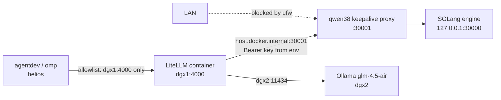

# Running Qwen3.8-27B on SGLang behind LiteLLM (dgx1)

Step-by-step instructions for Option B in [qwen38-serving-options.md](qwen38-serving-options.md):
the [hasso5703/dgx-spark-qwen38](https://github.com/hasso5703/dgx-spark-qwen38/) stack (SGLang +
NVFP4 + DFlash2) on dgx1, reached only through LiteLLM. Unless a step says otherwise, run it on
dgx1. Written 2026-10-29; nothing here has been tried on dgx1 yet.



## 0. Before you start

```bash
# On helios: no factory-test run may be using dgx1's GPU (this should print nothing)
podman ps --format '{{.Names}}' | grep agentdev

# On dgx1: free the memory. Stopping Ollama is the reliable way: an Ollama route on dgx1
# would otherwise reload a model mid-test and risk running out of memory. glm-4.5-air
# lives on dgx2 and is unaffected.
sudo systemctl stop ollama
nvidia-smi --query-gpu=memory.used --format=csv
```

## 1. Get the installer and read it

```bash
cd ~ && git clone https://github.com/hasso5703/dgx-spark-qwen38.git
cd dgx-spark-qwen38
less install.sh run.sh *.service.template
```

The README offers a `curl | bash` one-liner. Do not use it; read the scripts first. Look for:

- anything it changes outside its own directory, and any `sudo` steps;
- what it does to Docker and to the firewall;
- the setting that controls the **bind address of the 30001 proxy** (needed in step 3);
- the **name of the systemd service** (needed for rollback).

## 2. Install the 27B lane with the native 262k context

```bash
CONTEXT_MODE=native ./install.sh
```

Native mode reserves about 50% of memory instead of 76%. The default 1M-token window costs
memory the coder does not need.

To try it in the foreground first, without installing a boot service:
`CONTEXT_MODE=native ./install.sh --no-service && ./run.sh`.

Expect about 100 GB of downloads and image builds. Then:

```bash
./bench.sh                              # the author's single-stream benchmark (claims about 71 tok/s)
ss -ltnp | grep -E ':3000[01]'          # what address are 30000 and 30001 bound to?
wc -c ~/.config/qwen38/api-key          # the key exists; never print it
```

## 3. Let LiteLLM's container reach port 30001

LiteLLM reaches the host as `host.docker.internal`, which is the Docker bridge gateway, not
127.0.0.1.

- **If `ss` shows 30001 on `127.0.0.1` only:** LiteLLM cannot reach it. Use the bind setting
  found in step 1 to bind the proxy to `0.0.0.0`, or to the bridge gateway:
  `docker network inspect bridge --format '{{(index .IPAM.Config 0).Gateway}}'`.
- **Keep it off the LAN,** so every request has to go through LiteLLM:
  ```bash
  sudo ufw allow from 172.17.0.0/16 to any port 30001 proto tcp   # your Docker bridge subnet
  sudo ufw deny 30001/tcp
  ```
- **Check from inside the LiteLLM container.** A 401 is fine: it means the port is reachable
  and only lacks the key.
  ```bash
  docker exec litellm curl -s -m 5 -o /dev/null -w '%{http_code}\n' \
    http://host.docker.internal:30001/v1/models
  ```
- **Check from another LAN machine.** This must time out:
  `curl -m 5 http://192.168.2.29:30001/v1/models`.

## 4. Give LiteLLM the key, through its environment

The key must never appear in `config.yaml`. The `litellm` container was started with
`docker run` (there is no compose project), so adding an environment variable means
recreating it with the same settings.

Record its current settings. These commands print variable names only, never values:

```bash
docker inspect --format '{{range .Config.Env}}{{println (index (split . "=") 0)}}{{end}}' litellm
docker inspect --format '{{.HostConfig.Binds}} {{.HostConfig.PortBindings}} {{.HostConfig.ExtraHosts}} {{.HostConfig.RestartPolicy.Name}}' litellm
```

Put the key in a file only you can read:

```bash
printf 'QWEN38_API_KEY=%s\n' "$(cat ~/.config/qwen38/api-key)" > ~/litellm/qwen38.env
chmod 600 ~/litellm/qwen38.env
```

Recreate the container with the same `-v`, `-p`, `--add-host`, `--restart` and existing
`-e`/`--env-file` flags, plus `--env-file ~/litellm/qwen38.env`. The image is
`ghcr.io/berriai/litellm:main-stable`, and the command is
`--config /app/config.yaml --port 4000`.

## 5. Add the route

```bash
cp -p ~/litellm/config.yaml ~/litellm/config.yaml.bak-$(date +%Y%m%d-%H%M%S)
```

In `~/litellm/config.yaml`, after the `local-qwen27` route:

```yaml
  - model_name: local-qwen27-fast
    litellm_params:
      model: openai/qwen3.8-27b
      api_base: http://host.docker.internal:30001/v1
      api_key: os.environ/QWEN38_API_KEY
```

```bash
docker restart litellm
```

## 6. Test through LiteLLM only (from helios)

```bash
L=http://dgx1.herlein.me:4000

# The route exists
curl -s $L/v1/models | jq -r '.data[].id' | grep local-qwen27-fast

# It answers, and returns its thinking
curl -s $L/v1/chat/completions -H 'Content-Type: application/json' \
  -d '{"model":"local-qwen27-fast","messages":[{"role":"user","content":"What is 17*23? Number only."}],"max_tokens":2000}' \
  | jq -c '{content: .choices[0].message.content, thinks: (.choices[0].message.reasoning_content != null), usage}'

# Speed: a streamed coding answer; divide completion tokens by total time
curl -sN $L/v1/chat/completions -H 'Content-Type: application/json' \
  -d '{"model":"local-qwen27-fast","stream":true,"stream_options":{"include_usage":true},"max_tokens":1500,
       "messages":[{"role":"user","content":"Write a Go function that parses PNG chunk headers with full error handling."}]}' \
  -w '\ntotal %{time_total}s\n' | grep -E '"completion_tokens"|^total' | tail -2

# Tool calling: omp depends on it. Expect a tool_calls entry, not plain text.
curl -s $L/v1/chat/completions -H 'Content-Type: application/json' -d '{"model":"local-qwen27-fast","max_tokens":1000,
  "messages":[{"role":"user","content":"List the files in /tmp."}],
  "tools":[{"type":"function","function":{"name":"bash","description":"Run a shell command",
    "parameters":{"type":"object","properties":{"command":{"type":"string"}},"required":["command"]}}}]}' \
  | jq -c '.choices[0].message.tool_calls'
```

To compare, run the same speed test against `local-qwen27`, the Ollama q8 baseline. Ollama
must be running for that, so do it before step 0 or after rollback.

**Pass criteria**

| Check | Pass |
|---|---|
| speed | well above about 13 tok/s, the Ollama q8 baseline; published DFlash2 numbers are 48–71 |
| thinking | `thinks: true` |
| tool calling | a well-formed `bash` call in `tool_calls` |

It is not yet known whether SGLang's tool-call format passes through LiteLLM's `openai/`
provider unchanged. The tool-calling test is what settles it.

## 7. Point the factory test at it

In `factory-test/omp-seed/qwen/.omp/agent/`:

- **`models.yml`:** set the model id to `local-qwen27-fast`, keep `reasoning: true` and
  `contextWindow: 262144`, and update the name and comment.
- **`config.yml`:** set every role to `litellm/local-qwen27-fast`.
- **`factory.sh`:** in `write_meta_start`, set `"coder": "local-qwen27-fast"`, so
  `make results` shows which backend each run used.

Then run `make run LABEL=qwen27-sglang`. Use `make results` to compare its anchor score, its
timings and the number of audit rounds it reached against the Ollama q8 run.

## Rollback

```bash
sudo systemctl disable --now <qwen38 service from step 1>   # or stop ./run.sh
# Delete the local-qwen27-fast route, or restore config.yaml.bak-<timestamp>, then:
docker restart litellm
sudo systemctl start ollama
```

To remove the key, delete `~/litellm/qwen38.env` and recreate the LiteLLM container without
it. To reclaim the disk space, remove the repo's Docker image and its Hugging Face cache.

## Unconfirmed

- the exact name of the setting that controls the proxy's bind address on 30001 (step 3);
- the systemd service's name (rollback);
- whether tool calls survive LiteLLM's `openai/` provider (step 6 tests it).
