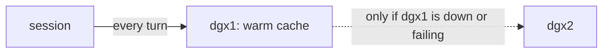
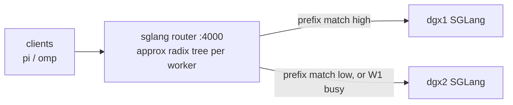
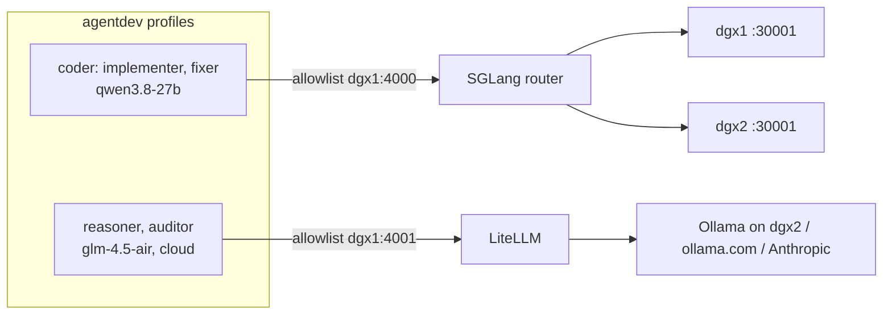

# SGLang router vs LiteLLM for the factory test

Written 2026-10-30, after dgx1 moved LiteLLM to `:4001` and put the SGLang router on `:4000`.
Follows [qwen38-sglang-behind-litellm.md](qwen38-sglang-behind-litellm.md).

## Summary

agentdev profiles and omp seeds already name the exact model and endpoint for every role, so
LiteLLM's model aliasing and remapping no longer earn anything. What LiteLLM still does well is
be a gateway to other providers (Ollama on dgx2, ollama.com, Anthropic): one OpenAI-shaped
endpoint, provider keys kept on dgx1, spend logs. The SGLang router does something config cannot:
pick which **host** serves `qwen3.8-27b`, keep a session on the host that holds its prompt cache,
and route around a dead host. Use each for that job, and do not chain them.

## What is on dgx1 now

| Port | Service | Serves | Client auth |
|---|---|---|---|
| `:4000` | `sglang-router.service` (systemd, venv in `~/sglang-router`) | `qwen3.8-27b` only, from workers `127.0.0.1:30001` (dgx1) and `dgx2.herlein.me:30001` | Completions need the LiteLLM master key; `/v1/models` is open |
| `:4001` | `litellm` container | Everything else in `config.yaml` (glm, claude, ollama.com models, …) | LiteLLM master key |
| `:30001` | qwen38 keepalive proxy (dgx1 and dgx2) | One SGLang engine each | qwen38 Bearer key |

Router flags: `--policy cache_aware --worker-startup-timeout-secs 600`, with `--api-key` set. On
helios the router key is in `~/.config/sglang-router/api-key` (mode 600).

## Why a session should stay on one host

Every agent turn resends the whole conversation: system prompt, stage prompt, and every tool call
and result so far. By the implementer's later turns that is tens of thousands of tokens.

- SGLang's RadixAttention keeps the KV cache of prefixes it has seen. On the same host, turn N+1
  prefills only the new tail. The SGLang log shows the rest as `#cached-token`.
- With LiteLLM's `simple-shuffle` across two deployments, each turn has about even odds of
  landing on the other box, which has never seen the conversation and prefills all of it. On a
  dense 27B model with 50–100k tokens of context, that is a large cost on every switch. Both
  boxes also hold half-warm copies of every session, which evicts other sessions sooner.
- Pinning is not needed for correctness: the chat API is stateless, and any host can answer any
  turn. One caveat is that if the two hosts drift apart (another SGLang build, other flags), a
  session that hops between them can behave differently turn to turn. Pinning removes that too.

The target is **soft affinity**: a session stays on its host and moves only when that host is
down or swamped. Load still spreads, because different sessions land on different hosts.

### The incident that showed it (2026-10-30, ~10:37)

A pi implementer run in `~/testit2` went through LiteLLM, which shuffled one request to dgx2.
dgx2's `qwen38-sglang` container was then restarted by hand and sat in warmup returning `503`,
with torch inductor errors (`PassManager::run failed`). LiteLLM's `timeout: 3600` meant it would
hold that request for up to an hour before retrying on dgx1, which was idle. The run looked hung.

## The SGLang router

The router (`pip install sglang-router`, newer releases called the **SGLang Model Gateway**) is a
Rust load balancer for several SGLang workers that serve the same model.

How `cache_aware` (the default policy) works:

1. The router keeps an approximate prefix tree per worker, built from the text of requests it
   sent there. It estimates each worker's cache without asking the worker.
2. A new request is matched against each tree. If the best match is above `--cache-threshold`
   (default about 0.5), it goes to that worker, so an agent session's next turn returns to the
   same host, with no session ID needed. Otherwise it is treated as new and goes to the least
   loaded worker.
3. If queues get too uneven (`--balance-abs-threshold`, `--balance-rel-threshold`), it switches
   to shortest-queue until load evens out.
4. Trees are pruned on a timer (`--eviction-interval`, `--max-tree-size`).

Other policies: `random`, `round_robin`, `power_of_two`.

It also does health checks and removes failed workers, retries (newer versions add circuit
breakers), serves the OpenAI-compatible API, and exports Prometheus metrics per worker. Optional
features not used here: Kubernetes worker discovery, prefill/decode disaggregation, and the
Gateway's gRPC and router-side parsing.

Limits:

- The cache view is an estimate. After a worker restart, its tree is stale until eviction, so
  "warm" sessions sent there prefill from scratch once. That costs time but is not an error.
- It serves SGLang workers only. It has no other providers, no spend tracking, no virtual keys.
- It is one more service to run, and its version should roughly track SGLang's. Flag names have
  changed between router and Gateway releases; check them against the installed version.

## Comparison, given that agentdev config already names each model

| Concern | Covered by agentdev config? | LiteLLM | SGLang router |
|---|---|---|---|
| Which model a role uses | **Yes**: profiles and omp seeds name it | Aliases and remapping add little now. A remap is a hidden second place where the model gets decided | Doesn't do this; it serves one model |
| Which host serves it | No. Config can name a single host, which gives no failover | Shuffle or least-busy, with no cache awareness. Sessions hop and re-prefill | **Cache-aware**: a session stays on the host holding its prefix |
| A host dying mid-run | No | Retries and cooldown, but only after `timeout` (3600s today) | Health checks remove the worker; failover is fast |
| Other providers (Ollama on dgx2, ollama.com, Anthropic) | Config names them; something must speak each API | **Yes**: one OpenAI-shaped endpoint, format translation | No |
| Provider API keys | Containers would otherwise need them | **Yes**: keys stay on dgx1; containers carry only the master key | Holds only the qwen key |
| Egress allowlist | One `host:port` per profile | One port reaches every model LiteLLM serves, paid cloud ones included | One port reaches only local qwen |
| Spend, logging, rate limits | No | Yes | Prometheus metrics per worker; no spend |
| Thinking control (`chat_template_kwargs.enable_thinking`) | pi and omp send it | Passed through (tested 2026-10-30) | Passed through (tested 2026-10-30) |

## Recommendation

- **qwen roles** (implementer, fixer) point at the router on `dgx1:4000` with the router key.
  Their egress allowlist is that one port, which reaches only local qwen, a tighter blast radius
  than LiteLLM.
- **Other roles** (reasoner, auditor: `glm-4.5-air` on dgx2's Ollama, and any cloud model) point
  at LiteLLM on `dgx1:4001`, which keeps the provider keys and spend logs.
- **LiteLLM keeps no `qwen3.8-27b` deployments**, so qwen traffic cannot take the uncached path by
  accident. Do not put LiteLLM in front of the router: it adds a hop and a second timeout to tune,
  and buys nothing once config names the model.
- If LiteLLM stays in any qwen path, set a short `stream_timeout` and turn on health checks
  (`enable_pre_call_checks` or `background_health_checks`), so a dead backend fails over in
  seconds, not an hour.

## Current impact on the factory test

As of this writing, `make run` is broken. The factory's LiteLLM routes (reasoner, auditor, and
`CODER=litellm`) still point at `dgx1:4000`, which is now the router: it serves only
`qwen3.8-27b` and requires a key. `CODER=sglang` still works for the coder, but its reasoner
and auditor go through LiteLLM and break the same way.

To match the recommendation:

1. Reasoner and auditor seeds and profiles: `:4000` to `:4001`, plus the LiteLLM master key,
   which LiteLLM now requires.
2. Coder seed and profile: point at the router on `:4000` with the router key, passed to the
   container the same way `CODER=sglang` passes the qwen38 key (copied into the omp home for
   the step, deleted afterwards).

## Running the stages by hand

`factory-test/pi-stages.sh WORK_DIR` runs brainstorm, designer, implementer, `make build && make
test`, and the auditor with pi on the host, through the router by default
(`~/.pi/agent-router/models.json`, model `router/qwen3.8-27b`). Each stage runs only if the
previous one finished cleanly. Logs go to `WORK_DIR-logs/`.
