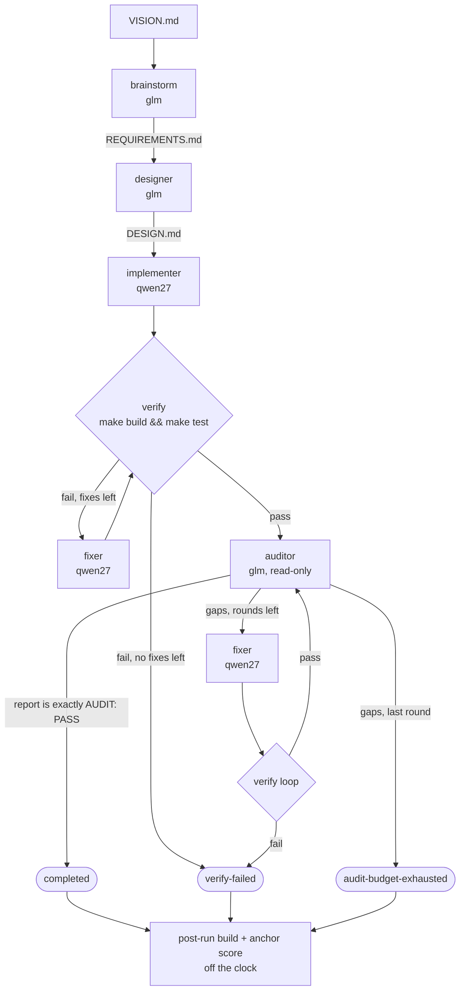

# factory-test workflow

How one `make run` turns a vision document into a scored program. Each step is a fresh
agentdev container. `factory.sh` plays the "lead": it decides the step order, the budgets and
the outcome in code, not in a prompt.

## The task

The input is `task/VISION.md`, a description of `pngdec`: a command-line tool that reads a
PNG file, validates its chunk structure and prints JSON. It must use only the Go standard
library. A frozen acceptance suite of 32 cases (`task/anchor/`) judges the result. No agent
ever sees the suite.

## Roles

| Role | Steps | Model (via LiteLLM on dgx1) | Workspace | Network |
|---|---|---|---|---|
| reasoner | brainstorm, designer | `glm-4.5-air` (Ollama on dgx2) | read-write | LiteLLM only |
| coder | implementer, every fixer | `qwen3.8-27b` = Qwen3.8-27B NVFP4 + DFlash2 (SGLang on dgx1) | read-write | LiteLLM only, or the SGLang proxy only with `CODER=sglang` |
| auditor | audit-N | `glm-4.5-air` | **read-only** | LiteLLM only |
| sandbox | verify, post-run build | none, just `make` | read-write | **none** |
| scorer | anchor score | none, just `go test` | candidate mounted read-only | **none** |

Every agent is omp running one-shot. Its home is reseeded from `omp-seed/` before every step,
so no step inherits another step's conversation. The seed declares exactly one model and
disables the cloud providers, and the network allowlist admits only
`dgx1.herlein.me:4000`. An agent therefore cannot reach a cloud model, download a Go
module, or talk to Ollama directly.

## The pipeline

1. **brainstorm.** Reads `VISION.md` and writes `REQUIREMENTS.md`, with numbered, testable
   requirements. If the file is missing or empty, the run ends as `no-REQUIREMENTS.md`.
2. **designer.** Reads both documents and writes `DESIGN.md`: numbered rules, rejection
   cases and the build and test contract. The audit later checks the code against this
   document. If the file is missing or empty, the run ends as `no-DESIGN.md`.
3. **implementer.** Writes the Go source, its own tests and a Makefile from `DESIGN.md`.
4. **verify loop.** The sandbox runs `make build && make test` with no network. On failure,
   the last 200 lines of output go to a fixer, which gets `prompts/fixer.md` followed by the
   report. Then verify runs again. There are up to `VERIFY_RETRIES` (3) fixes. If verify still
   fails after them, the run ends as `verify-failed`. Each verify has its own 10-minute cap.
5. **audit loop.** The auditor reads `DESIGN.md`, `REQUIREMENTS.md` and the source on a
   read-only mount, and reports gaps against the numbered rules. It must not rely on the
   author's tests.
   - **Pass:** the whole report, ignoring blank lines, is exactly `AUDIT: PASS`. A report
     that lists gaps and also says `AUDIT: PASS` fails; the first run was a false pass of
     exactly this kind.
   - **Gaps:** the report goes to a fixer, then through the verify loop, and the auditor
     looks again. There are up to `AUDIT_CYCLES` (3) audit rounds. Gaps on the last round
     end the run as `audit-budget-exhausted`.
6. **score** (off the clock). The sandbox runs `make build` once more. The scorer then runs
   the frozen 32-case suite against `/candidate/pngdec`. It mounts the candidate read-only
   and has no network, so nothing the agents wrote can influence the measurement. The
   result goes to `score.json`.

## The clock

`RUN_TIMEOUT` (90 minutes) covers every agent step and every in-band verify. Each step runs
under `timeout` with whatever time is left. If the clock runs out mid-step, the step gets
TERM, then KILL 60 seconds later. agentdev's signal handling removes the container and its
proxy, and the run ends as `capped`. Scoring always runs, so a capped run is still measured
on what it produced.

## Outcomes

| Outcome | Meaning |
|---|---|
| `completed` | verify passed and an audit report was exactly `AUDIT: PASS` |
| `audit-budget-exhausted` | verify passed, but the last audit round still found gaps |
| `verify-failed` | the build or the agent's own tests still failed after the fix budget |
| `capped` | the 90-minute clock ran out |
| `no-REQUIREMENTS.md`, `no-DESIGN.md` | a reasoner step produced nothing |

The outcome says how the pipeline judged itself. The anchor score (`passed/32`) is the
independent measure. A run can reach `completed` and still score poorly if the design and
the audit share a blind spot.

## What a run leaves behind

Everything is under `runs/<timestamp>-<label>/`:

| Path | Contents |
|---|---|
| `meta.json` | models, budgets, agentdev commit, image id, task hash, outcome, per-step timings |
| `timeline.tsv` | one row per step: name, profile, exit code, seconds |
| `work/` | the final workspace: documents, source, binary |
| `history.git` | one commit per step, kept outside `work/` so agents never see it |
| `logs/` | stdout and stderr per step, verify and audit reports, and the spent omp homes |
| `homes/*/agentdev-egress.log` | every request an agent made, ALLOW or DENY |
| `homes/*/.omp/agent/sessions/` | full agent transcripts |
| `score.json` | `passed`, `total`, `failed_cases` |

To see the history step by step:
`git --git-dir=runs/<run>/history.git log --stat`. To compare runs: `make results`.
