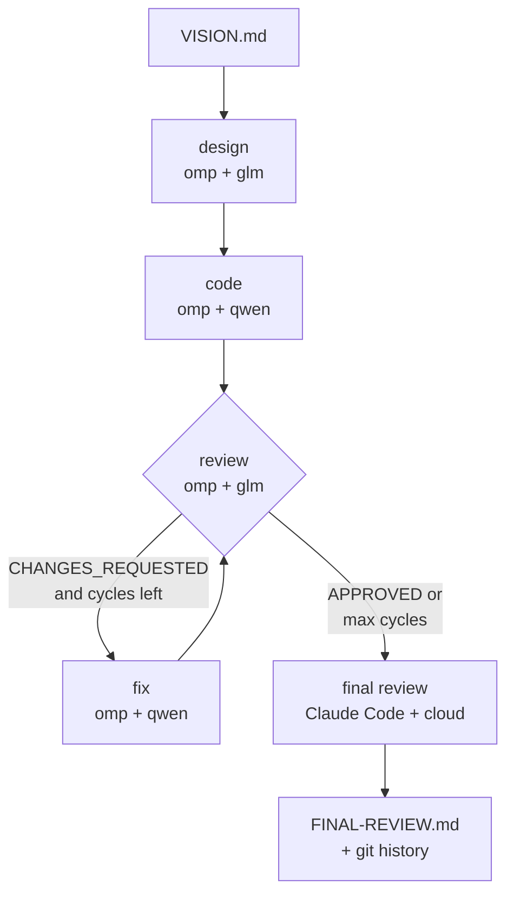

# local-cycle-test

Build a project from a `VISION.md` using local models for the bulk of the work and a cloud model
only for the final check. Every step is a separate agentdev one-shot run, each in its own
container, all sharing one `project/` workspace.

| Step | Profile | Agent | Model | Where it runs |
|---|---|---|---|---|
| design | `design-glm.json` | omp | `glm-4.5-air` | Ollama on dgx2, via LiteLLM on dgx1 |
| code | `code-qwen.json` | omp | `local-qwen` (`qwen3-coder-next:q8_0`) | Ollama on dgx1, via LiteLLM |
| review (repeated) | `design-glm.json` | omp | `glm-4.5-air` | local |
| fix (repeated) | `code-qwen.json` | omp | `local-qwen` | local |
| final review | `review-claude.json` | Claude Code | `opus` | Anthropic cloud, using your claude.ai Teams login |

The split follows each model's strength. GLM is the stronger general reasoner, so it designs and
reviews. Qwen3-Coder is tuned for code, so it implements and fixes. A frontier model reviews once
at the end, after the cheap local loop has already converged.



## Prerequisites

- `agentdev` on your `PATH` (or set `AGENTDEV=/path/to/agentdev`), and the image pulled.
- LiteLLM reachable at `http://dgx1.herlein.me:4000`, serving `glm-4.5-air` and `local-qwen`.
- For the final step, you are logged in to `claude` on this host (`~/.claude/.credentials.json`,
  or `$CLAUDE_CONFIG_DIR`). agentdev copies that login into the container for the one run
  (`host_login`), and the copy is discarded on exit.
- An agentdev image that includes the plain-HTTP keep-alive proxy fix (merged 2026-10-29; run
  `make build`). With an older image, a local step fails on its second model request with
  `404 {"detail":"Not Found"}`, because LiteLLM speaks plain HTTP.

## Run it

```bash
cd local-cycle-test
./orchestrate.sh ~/path/to/VISION.md        # up to 3 review/fix cycles (default)
./orchestrate.sh ~/path/to/VISION.md 5      # up to 5 cycles
SKIP_FINAL=1 ./orchestrate.sh VISION.md     # local models only; no cloud review
```

`orchestrate.sh` refuses to start if `project/` already exists. Move or delete it to start a new
run.

### What you get

- `project/` is the generated code, in its own git repo with one commit per step:
  `git -C project log --oneline`.
- `project/REVIEW-<n>.md` holds each local review, and `project/REVIEW.md` is the latest.
- `project/FINAL-REVIEW.md` is the cloud review, ending in `VERDICT: APPROVED` or
  `VERDICT: CHANGES_REQUESTED`. The script's exit status is 0 only on APPROVED.
- `runs/<timestamp>/` holds each step's stdout (`.out`) and agentdev's stderr (`.err`). It also
  keeps each step's spent omp home under `homes/`, including the omp session, its logs, and
  `agentdev-egress.log`: every connection the step made or was refused, since `network.log` is on.

## How the pieces fit

### Model routing for omp

agentdev passes no model flag to omp, so each local profile gets its own **omp agent home**
(`mounts.agent_folder: ./homes/glm` or `./homes/qwen`). The orchestrator copies it fresh from
`omp-seed/` before every step. The seed holds two files:

- `.omp/agent/models.yml` declares one provider, `litellm`, at `http://dgx1.herlein.me:4000/v1`
  using the OpenAI chat API. It declares exactly one model, with no discovery, because LiteLLM also
  routes cloud models (`claude-sonnet`, `gpt-oss-120b-cloud`, and others) and those must not be
  selectable. `supportsStore: false` is required: LiteLLM rejects OpenAI's `store` parameter for
  Ollama models.
- `.omp/agent/config.yml` points every model role (default, smol, plan, slow, commit) at that one
  model, and disables the `anthropic`, `openai`, and `google` providers.

The fresh copy per step means no step inherits another's omp memory or session. Each step sees
only what is in `project/`.

### Isolation

- **Local steps:** network `allowlist` with a single entry, `dgx1.herlein.me:4000`. The host
  name must be fully qualified; short LAN names like `dgx1` do not resolve under allowlist (see
  the agentdev README). SSH and USB are off.
- **Final step:** a read-only workspace, so the cloud reviewer cannot change the code. Egress goes
  only to `api.anthropic.com`, `statsig.anthropic.com`, and `platform.claude.com` (the OAuth
  token refresh host).
- **Reviewers never change code.** The local review step shares the design profile, whose
  workspace is writable. Any edit a reviewer makes is therefore discarded with
  `git checkout`/`git clean` before its review is recorded, and the discarded file list is saved
  in `runs/<timestamp>/review-<n>.discarded`.

### Verdicts

Reviews are captured from the agent's stdout, not from a file it writes. The last
`VERDICT: APPROVED|CHANGES_REQUESTED` line decides the outcome. A review with **no** verdict
counts as `CHANGES_REQUESTED`, so a confused local model can never approve by accident.

### Prompts

`prompts/` holds one file per step: `design.md`, `code.md`, `review.md`, `fix.md`, and
`final-review.md`. Edit them to change house rules, such as the language or the Makefile targets.
The orchestrator passes each one with `agentdev --prompt`.

## Driving it from another orchestrator (including an agent)

`orchestrate.sh` is a reference. The contract is just five commands, run from this directory:

```bash
agentdev -c design-glm.json   --prompt prompts/design.md       # writes project/DESIGN.md
agentdev -c code-qwen.json    --prompt prompts/code.md         # writes the code
agentdev -c design-glm.json   --prompt prompts/review.md  > review.out   # verdict on the last line
agentdev -c code-qwen.json    --prompt prompts/fix.md          # reads project/REVIEW.md
agentdev -c review-claude.json --prompt prompts/final-review.md > final.out
```

An agent orchestrator, such as Claude Code on your host, can run these with its shell tool. It
should follow the same rules as the script:

- run one step at a time, because the profiles share `project/` and each omp home is
  single-instance;
- re-seed `homes/<glm|qwen>` from `omp-seed/` before each local step;
- write each review's stdout to `project/REVIEW.md` before the next fix;
- stop the cycle on APPROVED or after N cycles.

Write each step's prompt as a file and pass it with `--prompt`. agentdev has no inline `-p`.

## Adapting

- **Different local models:** change the model `id` (a LiteLLM model name) and `contextWindow` in
  `omp-seed/<seed>/.omp/agent/models.yml`, and the `modelRoles` in `config.yml`. List what
  LiteLLM serves with `curl -s http://dgx1.herlein.me:4000/v1/models`. Only the routes backed by
  `ollama_chat/...` are local.
- **Different cloud model:** change `one-shot.model` in `review-claude.json` (for example
  `sonnet`).
- **An API key instead of your Teams login:** set `"host_login": false` in `review-claude.json`,
  and inject a `.env` holding `ANTHROPIC_API_KEY` with `workspace.files`.
